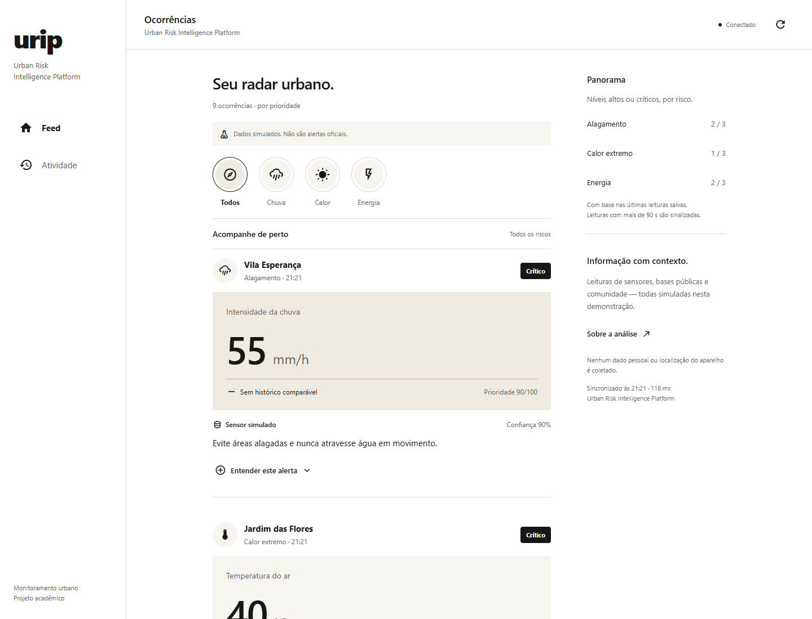

# Urban Risk Intelligence Platform — URIP

Urban Risk Intelligence Platform acadêmica. Java/Spring Boot + React Native/Expo no mesmo repositório. Monitora **alagamentos, calor extremo e falta de energia** em três bairros fictícios. Sensores, bases públicas e relatos comunitários são **simulados**, inclusive quando enviados pela API. Não há integração com fontes oficiais.



## Equipe

| Integrante | RM |
|---|---|
| Lucas Zolla Assis | 557952 |
| Lucas Baraldi Rodrigues | 555407 |
| Vitor Pantarotto de Brito | 554961 |

## Video do projeto
https://youtu.be/mH2c3ANjEAg

## Conferência da entrega

Consulte a [matriz do enunciado](docs/ENTREGA.md), o [registro de teste Android](docs/TESTE-ANDROID.md). O projeto usa análise explicável, lista de eventos e avisos no app aberto — não um modelo treinado, mapa obrigatório ou push em segundo plano.

Há um aviso transitivo de dependência sem correção upstream publicada na última verificação; veja [SECURITY.md](SECURITY.md). A aprovação dos testes não significa ausência de vulnerabilidades.

Para obter o código:

```sh
git clone https://github.com/VitorPDB/GS-mobile-dev.git
cd GS-mobile-dev
```

## Executar no Windows

Requisitos: Node.js 24, JDK 21 e Maven 3.9+. Caso não tenha Java/Maven, execute o instalador portátil abaixo; ele baixa ferramentas oficiais para `.tools/` e verifica checksums. Não modifica o Java instalado.

```powershell
powershell -ExecutionPolicy Bypass -File .\scripts\Setup-Windows.ps1
```

Em um terminal na raiz:

```powershell
powershell -ExecutionPolicy Bypass -File .\scripts\Start-Backend.ps1
```

Em outro terminal:

```powershell
powershell -ExecutionPolicy Bypass -File .\scripts\Start-App.ps1
```

Abra http://localhost:8081. API: http://localhost:8080/api/dashboard. Saúde: http://localhost:8080/actuator/health. O primeiro início do backend e do app baixa dependências. O modo local usa H2 **em arquivo** na pasta `backend/data/`, que preserva leituras ao reiniciar. Não execute dois backends usando o mesmo arquivo.

Alternativa com JDK/Maven já instalados: `cd backend` e `mvn spring-boot:run`; para o app: `cd mobile`, `npm ci`, `npm run web`. Use um terminal novo para cada processo.

## Android

Instale a versão do Expo Go compatível com o SDK 58 em https://expo.dev/go (selecione Android e SDK 58). Na pasta `mobile`, execute `npm start` e escaneie o QR code pelo Expo Go. Celular e computador devem estar na mesma rede. Antes de iniciar o Expo, defina `$env:EXPO_PUBLIC_API_URL='http://IP-DO-COMPUTADOR:8080'`; use `ipconfig` no Windows para consultar o IPv4. Permita a porta 8080 no firewall apenas na rede privada usada para a apresentação. Redes de universidade podem bloquear comunicação entre aparelhos.

No Android Emulator, o endereço padrão é `http://10.0.2.2:8080`. Com um emulador já aberto e o Android SDK configurado, use `npm run android`. O app usa componentes React Native reais, safe areas, paleta clara branco/creme e preto e tamanho de fonte do sistema. A versão web serve à demonstração no Windows; não é um executável nativo de Windows.

HTTP é permitido para desenvolvimento local no Android. Antes de publicar fora da rede local, use HTTPS e gere uma build apropriada. Não há APK assinado incluído. `npx expo export --platform android` verifica o bundle JavaScript, mas não substitui instalação e teste em aparelho.

## PostgreSQL / Docker

Com Docker Desktop instalado, na raiz execute `docker compose up --build`. Ele inicia PostgreSQL com volume persistente e backend em 8080. O app continua sendo iniciado separadamente. Para a demonstração, pare apenas o backend com `docker compose stop backend` e recupere com `docker compose start backend`. `docker compose down` preserva o volume; não use `-v` se quiser preservar os dados.

Copie `.env.example` para `.env` se precisar alterar parâmetros do backend. O app usa `mobile/.env` a partir de `mobile/.env.example` para o endereço da API, sem página de conexão. Variáveis EXPO_PUBLIC são incorporadas no bundle: reinicie o Expo ou exporte novamente após alterá-las. Endereços salvos pela antiga página de conexão são ignorados. Os valores padrão são exclusivos de desenvolvimento. No modo sem Docker, variáveis podem ser definidas no PowerShell antes de iniciar o backend, por exemplo `$env:DEMO_ENABLED='false'`. Com o modo demo desligado é obrigatório definir `INGEST_TOKEN` diferente do padrão. Fontes continuam marcadas como simuladas, pois esta versão é um protótipo.

## Demonstração sugerida

1. Inicie backend e app. Confirme **Conectado**, três riscos, horários e atualização das leituras a cada 12 segundos.
2. Abra um alerta. Explique medida, origem, confiança, pontuação, tendência e orientação. Use filtros e a aba Atividade.
3. Pare o backend com Ctrl+C no terminal dele (ou `docker compose stop backend`). Não pare o servidor Expo.
4. Em até cerca de 10 segundos, veja **Sem conexão**. Navegue pelos últimos dados, ainda disponíveis. Após 90 segundos sem novas leituras, elas aparecem como antigas. Atualização automática não apaga o cache ao falhar.
5. Recarregue o app com backend parado para mostrar persistência local (desde que o servidor Expo ainda esteja disponível). Um primeiro acesso sem cache mostra um estado vazio explicativo.
6. Reinicie o backend. O app reconecta automaticamente e recebe dados novos. Não precisa fechar o aplicativo.
7. Para demonstrar mudança de gravidade, envie a leitura abaixo e observe o aviso no app aberto. O simulador pode sobrescrever a leitura na rodada seguinte de 12 s. Avisos são **dentro do app em primeiro plano**, sem push ou execução em segundo plano. Se a avaliação exigir push, esse é um requisito adicional a implementar.

```powershell
$headers = @{ 'X-Ingest-Token' = 'local-demo-only' }
$body = @{ type='HEAT'; source='PUBLIC_DATA'; district='Vila Esperança'; value=42 } | ConvertTo-Json
Invoke-RestMethod -Uri http://localhost:8080/api/readings -Method Post -Headers $headers -ContentType 'application/json' -Body $body
```

## API

| Método | Rota | Uso |
|---|---|---|
| GET | `/api/dashboard` | Alertas priorizados, 30 leituras recentes, horário do servidor, total persistido |
| POST | `/api/readings` | Ingestão de leitura simulada; exige `X-Ingest-Token` |
| POST | `/api/demo/tick` | Gera imediatamente nove leituras; exige chave e modo demo ativo |
| PUT | `/api/readings/{readingId}/reaction` | Voto público: `{ "clientId":"UUID", "vote":"LIKE" }`; também aceita `DISLIKE` e `NONE` |
| GET | `/actuator/health` | Disponibilidade |

Tipos: `FLOOD`, `HEAT`, `OUTAGE`. Fontes: `SENSOR`, `PUBLIC_DATA`, `COMMUNITY`. Corpo: `type`, `source`, `district` (até 60 caracteres), `value` numérico e `observedAt` ISO-8601 opcional. Valores aceitos: chuva 0–300 mm/h, temperatura 0–65 °C, interrupção 0–10080 min. Horário deve estar nas últimas 24 h, com tolerância futura de 30 s. Sem horário, usa o do servidor. Confiança é atribuída pelo servidor e não pode ser escolhida no payload.

## Análise explicável

Recurso de **análise**, atendendo à alternativa “IA ou análise” do enunciado. Não é um modelo treinado nem uma previsão validada. Faixas demonstrativas:

| Risco | Moderado (35 pontos) | Alto (65 pontos) | Crítico (90 pontos) |
|---|---|---|---|
| Chuva | ≥10 mm/h | ≥30 mm/h | ≥50 mm/h |
| Calor | ≥30 °C | ≥35 °C | ≥40 °C |
| Falta de energia | ≥15 min | ≥60 min | ≥120 min |

Abaixo da primeira faixa: 10 pontos, baixo. Tendência crescente adiciona 5 pontos (limite 100), comparando a leitura anterior da mesma fonte, risco e bairro nos últimos 30 minutos. Variação deve superar 0,5 °C ou 2 unidades para os outros riscos. A lista usa a pontuação decrescente e desempate estável. Valores antigos continuam visíveis e marcados; não são prova de risco atual.

Confiança base da categoria: sensor 90%, base pública 80%, comunidade 55%. Likes e dislikes ajustam a confiança no servidor pela fórmula **(base × 4 + likes) / (4 + likes + dislikes)**. A base entra como fração (90% = 0,90). Exemplos para sensor: sem votos 90%; um like 92%; um dislike 72%. Cada instalação pode ter um único voto ativo por risco e bairro: clicar novamente retira o voto e escolher o outro tipo troca o voto. Votos idênticos repetidos são idempotentes. Valem os votos das últimas 24 horas, compartilhados entre leituras desse acompanhamento para que os contadores não reiniciem a cada 12 s.

**Não é probabilidade de ocorrência, acurácia medida ou validação da medição individual.** A confiança combina a origem com apoio/contestação da comunidade; a gravidade física e a ordenação por prioridade não são reduzidas por dislikes. A explicação do cálculo está no detalhe de cada publicação. Calibração desses valores e dos limiares com especialistas é necessária para uso real. Chuva é um indicador demonstrativo; sem drenagem, relevo e nível da água não determina alagamento real.

## Arquitetura, proteção e limites

`api → service → repository → database`, com domínio separado. App: interface, hook de sincronização, cliente/validação e cache versionado por servidor. Ingestão de leituras protegida por chave; ela não é embarcada no app. A votação é pública e pseudônima, separada da ingestão; o app envia suas reações e consulta dados simulados. CORS permite origens explícitas, não autentica clientes. No navegador usando outro host/porta, ajuste `CORS_ORIGINS` e reinicie o backend. No app nativo não se aplica CORS.

O app não solicita nome, GPS ou telefone. Banco guarda bairro fictício, medida, tipo, fonte e horário. App salva um UUID aleatório por instalação e o último snapshot no armazenamento local, sem criptografia. O servidor guarda esse identificador pseudônimo com risco/bairro, voto e horário. Não há vínculo com conta, nome, GPS ou telefone. O UUID não é credencial de autenticação e não aparece nos dashboards públicos. Snapshots são separados por servidor e instalação. Leituras com mais de sete dias são removidas periodicamente. Votos deixam de contar ao completar 24 horas e são removidos na limpeza horária seguinte (retenção de até cerca de 25 h). Não envie dados pessoais nos campos livres.

O painel busca o último registro de cada combinação de risco e bairro independentemente do volume de leituras dos outros grupos. Uma ocorrência sem novas leituras continua visível como antiga até a retenção do banco removê-la. O histórico devolve até 30 leituras recentes. Há índices compostos para as buscas por grupo/fonte; o serviço ainda faz uma consulta de tendência por grupo, limitação do protótipo a considerar em cargas maiores. Para uso em escala, materializar o estado por bairro/risco, paginar histórico, usar migrações versionadas e índices compostos, limitar ingestão, autenticar produtores por identidade, validar fontes, configurar HTTPS, backups e monitoramento. O simulador deve rodar em instância única; múltiplas réplicas exigiriam um produtor externo/coordenado. Não se promete alta disponibilidade com uma única instância.

## Verificar

Backend: `mvn -B -f backend/pom.xml verify` ou `scripts/Start-Backend.ps1 -Test`.

Na pasta `mobile`:

```powershell
npm ci
npx expo install --check
npm run doctor
npm run check:android
npm run typecheck
npm test
npm run build:web
npx expo export --platform android --output-dir dist-android
```

Os testes cobrem limiares, tendência, confiança, leitura antiga, validação, chave de ingestão, CORS, cache, falha de rede e reconexão. O relatório em `docs/VALIDACAO.md` distingue execução comprovada de verificações ainda manuais. O CI roda verificações das duas stacks em pushes e pull requests.

### Teste completo no navegador (E2E)

Com JDK 21 disponível e o JAR gerado por `mvn -B -f backend/pom.xml package`, na pasta `mobile`:

```powershell
npm ci
npm run build:web
npx playwright install chromium
npm run test:e2e
```

O Playwright inicia o preview web automaticamente em 127.0.0.1:8091 e uma API própria em 127.0.0.1:8082, usando uma pasta `data/e2e-*` nova por execução como banco (preservada no reinício interno). **Não precisa iniciar o backend em 8080.** Reserve as portas 8091/8082 e não use um backend manual na porta 8082. O teste desliga e reinicia apenas a API que ele mesmo criou. As duas portas devem estar livres; o teste recusa a 8082 ocupada antes de criar seu processo. A saúde só é aceita depois que o filho criado termina de iniciar, e a parada tem limite de tempo. O teste redireciona apenas o host das chamadas HTTP do app para a API real em 8082. Nenhuma resposta JSON é simulada pelo Playwright. A API de teste é encerrada ao terminar.

Se o Java 21 não estiver no PATH, defina `$env:TEST_JAVA='C:\caminho\jdk-21\bin\java.exe'`. O instalador portátil cria esse executável dentro de `.tools/jdk/`. Opcionalmente, para usar um Chromium já instalado em vez do download do Playwright, defina `$env:PLAYWRIGHT_CHROMIUM_EXECUTABLE='C:\caminho\navegador.exe'`.

Há um override transitivo de `@expo/fingerprint → minimatch` para a versão 11 corrigida. Expo CLI, resolução de dependências, exportação web e Hermes foram verificados com essa combinação. Reavalie o override ao atualizar o Expo.

Indicadores: latência da resposta medida no app; horário da última sincronização; atualização simulada a cada 12 s e consulta a cada 5 s. Qualidade dos alertas é demonstrada por testes dos cenários/limiares, **sem alegar acurácia real**. Facilidade de uso precisa ser validada com usuários; não há pesquisa inventada.

## Votação e limites do protótipo

O GET dashboard aceita cabeçalho opcional `X-Client-Id` para devolver `myVote`. Inclui `likes`, `dislikes`, `baseConfidence`, `confidence` e `confidenceExplanation`. Respostas personalizadas usam Cache-Control no-store. A API de reações usa PUT e devolve 204; erro 409 indica leitura antiga ou conflito concorrente e requer atualizar/repetir. Leituras com mais de 90 s não recebem votos; o app não enfileira votos offline. O identificador persistido mantém a seleção ao recarregar. Sem armazenamento local disponível, a votação é desabilitada, preservando consulta.

É **um voto por instalação/ocorrência**, não uma pessoa verificada. Apagar os dados, usar outro navegador ou enviar outro UUID permite criar outra identidade. Não há login nem proteção antifraude/limitação robusta de abuso; a fórmula não deve ser usada para decisões reais sem validação, autenticação e controles contra manipulação. O UUID é gerado com Expo Crypto: https://docs.expo.dev/versions/v58.0.0/sdk/crypto/.

O H2 local e o banco E2E usam `WRITE_DELAY=0` para gravar o log sem o atraso padrão de buffer antes de confirmar commits. O teste encerra abruptamente o processo e verifica que leitura e voto persistem. Para URLs H2 customizadas em DB_URL, preserve esse parâmetro se desejar o mesmo comportamento. Referência: https://h2database.com/html/commands.html#set_write_delay.

A configuração Android usa os plugins oficiais expo-build-properties, expo-font e expo-system-ui. A verificação `check:android` inspeciona o manifesto produzido pelos plugins (HTTP da demonstração e backup desabilitado), sem afirmar instalação ou execução em aparelho.
